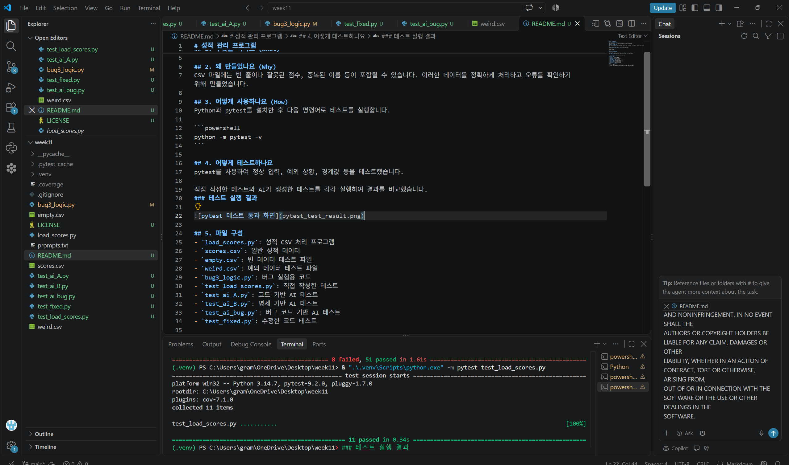

# 성적 관리 프로그램

## 1. 무엇을 하나요 (What)
성적 CSV 파일을 읽고 유효한 성적과 건너뛴 데이터를 구분하는 프로그램입니다.

## 2. 왜 만들었나요 (Why)
CSV 파일에는 점수가 비어 있는 행이나 잘못된 점수, 완전히 동일한 중복 행 등이 포함될 수 있습니다. 이러한 데이터를 정확하게 처리하고 오류를 확인하기 위해 만들었습니다.

## 3. 어떻게 사용하나요 (How)
Python과 pytest를 설치한 후 다음 명령어로 테스트를 실행합니다.

```powershell
python -m pytest -v
```

## 4. 어떻게 테스트하나요
pytest를 사용하여 정상 입력, 예외 상황, 경계값 등을 테스트했습니다.

직접 작성한 테스트와 AI가 생성한 테스트를 각각 실행하여 결과를 비교했습니다.

### 테스트 실행 결과



## 5. 파일 구성
- `load_scores.py`: 성적 CSV 처리 프로그램
- `scores.csv`: 일반 성적 데이터
- `empty.csv`: 빈 데이터 테스트 파일
- `weird.csv`: 예외 데이터 테스트 파일
- `bug3_logic.py`: 버그 실험용 코드
- `test_load_scores.py`: 직접 작성한 테스트
- `test_ai_A.py`: 코드 기반 AI 테스트
- `test_ai_B.py`: 명세 기반 AI 테스트
- `test_ai_bug.py`: 버그 코드 기반 AI 테스트
- `test_fixed.py`: 수정한 코드 테스트

## 6. 만든 사람 및 AI 활용
- 만든 사람: 김소윤
- 학번: 2026101070
- AI 활용: pytest 테스트 코드 작성, 오류 확인 및 코드 수정 과정에 활용했습니다.

## 7. 데이터 분석 (12주차)

### 데이터 파일
- `scores_2026.csv`: 성적 분석을 위한 원본 CSV 파일 (114행, 5개 열)
- `scores_2026_cp949.csv`: CP949 인코딩으로 저장된 성적 데이터
- `mini.csv`: 정제 및 검증을 위한 작은 데이터 파일
- `analysis.py`: 성적 데이터 정제 및 반별 평균 계산 함수
- `test_analysis.py`: 데이터 정제와 분석 결과를 검증하는 테스트 코드

### 데이터 구성
- 학번: 학생의 학번
- 이름: 학생 이름
- 반: 학생이 속한 반
- 과목: 과목 이름
- 점수: 학생의 과목별 점수

### 데이터 정제 과정
1. 점수가 비어 있는 행 제거
2. 완전히 동일한 중복 행 제거
3. 반과 과목 이름의 앞뒤 공백 제거
4. 점수가 0점 이상 100점 이하인 행만 유지

점수가 비어 있는 행은 실제 점수를 알 수 없으므로 제거했습니다. 정제 결과는 114행에서 100행으로 줄어들었습니다.

### 분석 결과
- 1반 평균: 78.24점
- 2반 평균: 71.44점
- 전체 데이터 행 수: 100행
- 전체 점수 합계: 7484점

### 검증 결과
- pytest 테스트 4개 통과
- 반별 점수 합계와 전체 점수 합계 일치 확인
- mini.csv를 이용한 직접 계산 결과와 함수 결과 일치 확인
- 공백 제거 및 점수 범위 조건을 일부러 변경하여 테스트 실패 확인

### 분석을 통해 알게 된 점
전체 평균만 비교하면 1반의 점수가 더 높지만, 과목별 평균을 비교하면 모든 과목에서 2반의 점수가 더 높게 나타났습니다. 이는 반마다 과목별 학생 수와 점수 분포가 다르기 때문입니다. 따라서 전체 평균뿐 아니라 과목별 결과와 데이터 구성을 함께 살펴보는 것이 중요하다는 점을 알게 되었습니다.
